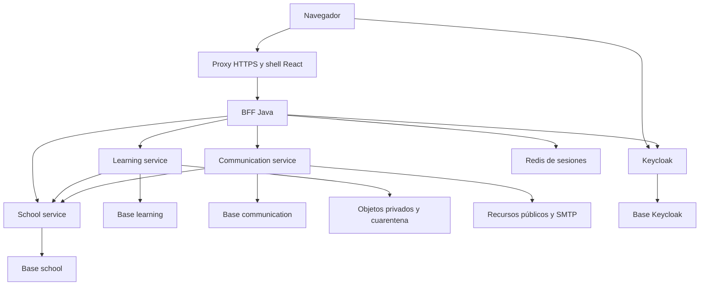
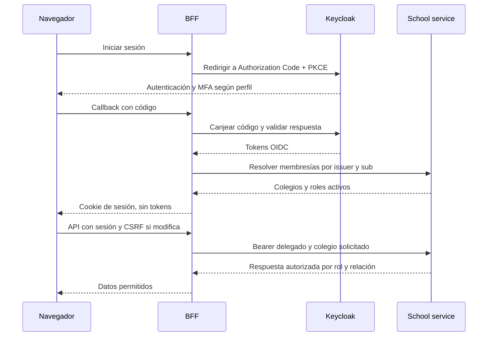
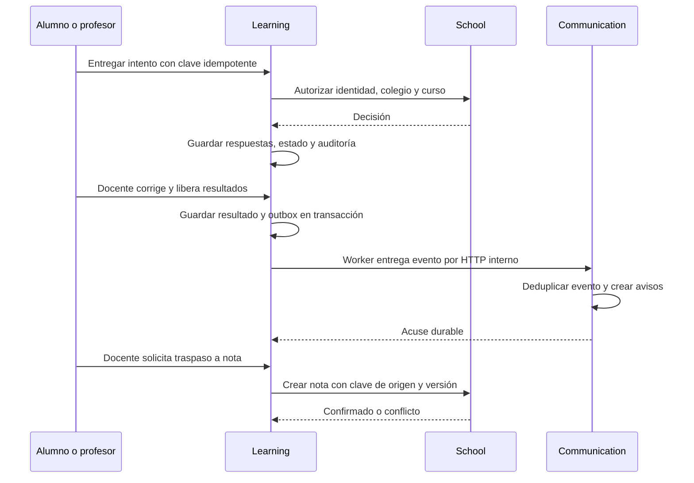

# Arquitectura propuesta

## Estilo y límites
Dos repositorios activos: Va-school-app contiene shell React/TypeScript, microfrontends Académico/Aprendizaje y web pública; Vq-school-backend contiene BFF Java, **tres microservicios de negocio Java** e infraestructura. Véase [ADR-0002](adr/0002-dos-repositorios-microfrontends.md). Java 21 LTS es la base propuesta; en HU-01 se fijan versiones exactas soportadas de Spring Boot, React, Node, Maven, Keycloak y contenedores. Esta definición no equivale a una matriz de versiones ya probada.

Se agrupa la operación académica e inspectoría en school-service para conservar transacciones locales. No se crea un microservicio por tabla. Learning y communication se separan por carga, ciclo de vida y responsabilidad. BFF mantiene la sesión y enruta; no contiene reglas académicas.

## Contenedores principales

Relaciones S/L → communication para eventos se detallan en el flujo de outbox; se omiten aquí para evitar cruces. El frontend usa Module Federation para dos remotos y una aplicación pública separada con prerender. El shell mantiene navegación y sesión; cada aplicación tiene build/imagen independiente.

| Componente | Posee | No posee |
|---|---|---|
| BFF | Sesión, tokens, CSRF, enrutamiento API y agregación ligera | Notas, reglas o persistencia académica |
| school-service | Colegios, membresías, provisión de usuarios, año, matrícula, horarios, notas, asistencia e inspectoría | Contraseñas, preguntas, archivos binarios o CMS |
| learning-service | Material/metadatos, preguntas, versiones de prueba, intentos, respuestas y corrección | Matrícula ni roles como fuente de verdad |
| communication-service | Páginas/noticias, campañas, destinatarios, bandeja y entrega de correo | Expedientes escolares completos |
| Keycloak | Credenciales, autenticación, MFA, sesiones SSO y recuperación | Autoridad final sobre cursos y pertenencia escolar |
| PostgreSQL | Base lógica y credencial propia por componente | Acceso cruzado a tablas |
| S3 compatible | Objetos privados/públicos separados y cuarentena | Autorización final del usuario |
| Redis | Sesión BFF y tokens con acceso de red restringido | Datos académicos persistentes |

Un clúster PostgreSQL puede alojar bases separadas en piloto; los servicios no comparten tablas ni usuario SQL. Keycloak también tiene base propia. No hay transacciones distribuidas ni joins cruzados.

## Login y acceso

Issuer canónico debe coincidir dentro y fuera de Docker. Validar issuer, firma/JWKS, audiencia, exp y nbf en cada servicio; no basta con validarlo en gateway. PKCE S256, state y nonce en login. No tokens en localStorage.

Membresías/roles de colegio viven en school-service; los roles de Keycloak sólo habilitan acceso grueso y política MFA. Learning/communication consultan autorización a school con identidad delegada en cada operación sensible, sin caché permisiva en MVP. Si school no responde, rechazan acceso con error de disponibilidad, no conceden permiso. Revocación comprobada en la siguiente solicitud; una descarga ya autorizada conserva la ventana residual máxima de 60 segundos.

## Corrección y consistencia

La última operación ocurre sólo con autorización docente y regla de conversión válida. Fallo devuelve sincronización pendiente/reintentable. No se presenta nota académica como registrada hasta confirmación. Una rectificación se sincroniza explícitamente sin pisar una corrección manual concurrente.

Outbox local se escribe con el negocio y lo entrega un worker por HTTP autenticado. Communication usa inbox con unicidad eventId + consumidor y destinatarios deduplicados. Backoff, máximo de intentos, cola de fallos y reconciliación. RabbitMQ/Kafka se posponen hasta justificar volumen; no son prerrequisito para microservicios.

## Archivos
Subida autorizada → objeto de cuarentena → validación de tamaño/tipo y escaneo → publicación de metadata → descarga con autorización fresca y URL de 60 segundos. Estado pendiente/rechazado nunca descargable. Recursos CMS públicos van a almacenamiento distinto; no reutilizar URLs públicas para material escolar.

## Disponibilidad y compromisos
Piloto en un host Docker Compose es una decisión de coste y simplicidad: **no es alta disponibilidad**. Caída de school bloquea acciones que requieren autorización. Redis y Keycloak son dependencias críticas. Se prioriza aislamiento y recuperación probada antes de escalar. Docker Swarm/Kubernetes, service mesh, broker y despliegue multirregión quedan fuera del MVP.

## Evolución
Separar inspectoría o calificaciones sólo ante carga/equipos independientes demostrables. Añadir broker sin cambiar contratos de evento; migrar sesiones y bases a servicios gestionados; portal de apoderado como módulo posterior con consentimiento y relaciones validadas.
