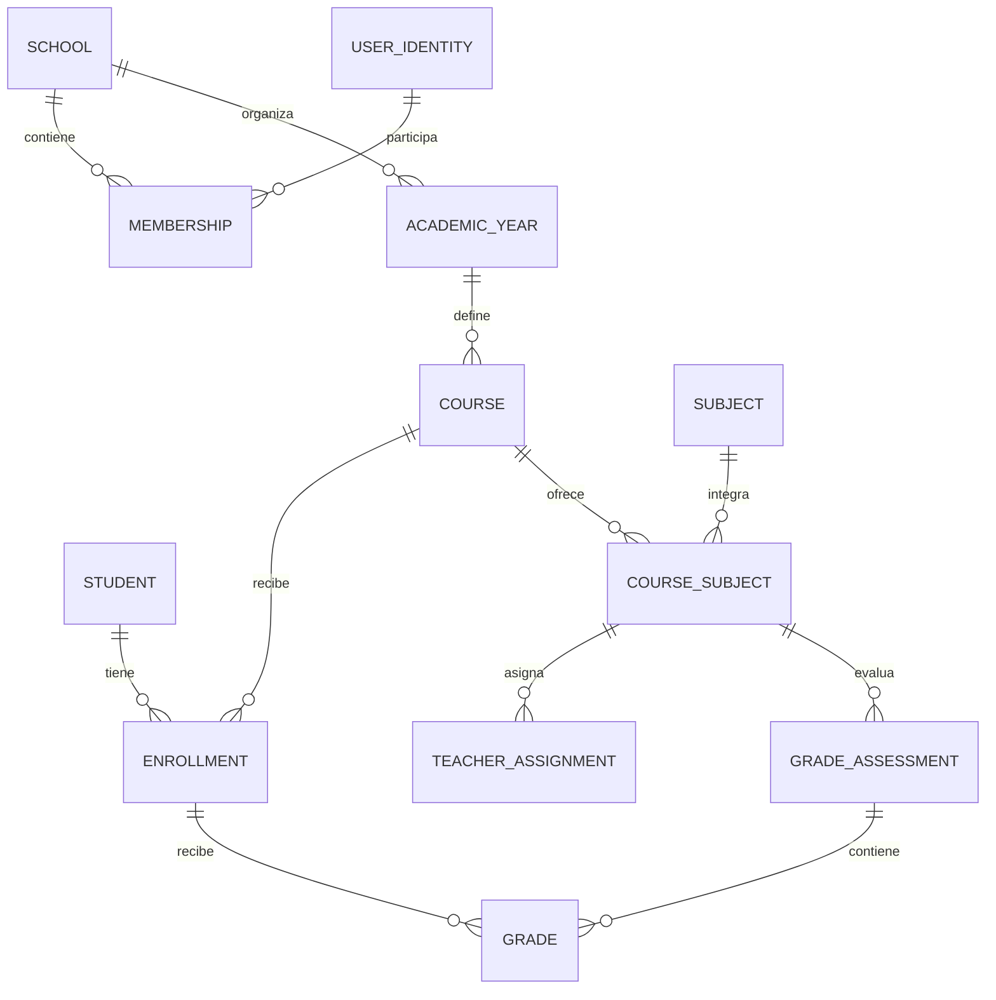

# Datos y contratos iniciales

Este es un diseño de entidades y catálogo de endpoints a formalizar en OpenAPI en HU-40; no son APIs implementadas.

## Propiedad de datos

| Servicio | Entidades principales |
|---|---|
| School | School, UserIdentity, Membership, AcademicYear, Period, Course, Subject, CourseSubject, TeacherAssignment, Student, Enrollment, GuardianContact, StudentGuardian, ScheduleVersion, ClassBlock, GradePolicyVersion, GradeAssessment, Grade, GradeRevision, ClassSession, Attendance, Observation, Departure, GuardianSummons |
| Learning | Material, Asset, Test, TestVersion, QuestionVersion, ChoiceVersion, Assignment, Attempt, Answer, Result, GradeSync |
| Communication | SiteSettings, Page, PageRevision, News, Campaign, Recipient, Notification, Delivery, InboxEvent |
| Infraestructura local de cada servicio | AuditEvent, OutboxEvent, IdempotencyRecord; no base compartida |
| Keycloak | Identidad de autenticación, credenciales, MFA y sesiones SSO; DB privada del proveedor |

UserIdentity es perfil de aplicación enlazado por issuer+sub. Student refiere al perfil; GuardianContact no implica cuenta. Todos los registros de dominio pertenecen a school_id; identidades globales y configuración técnica tienen excepciones explícitas.

## Relaciones académicas

Relaciones entre servicios son IDs de contrato, nunca FK a una base ajena. Learning usa course_subject_id y enrollment_id validados por School; conserva snapshots mínimos/versiones necesarios para historial.

## Invariantes de persistencia
- Unicidad (issuer, sub); (school, identity) para membresía; un conjunto de roles por membresía.
- Una matrícula activa por estudiante/colegio/año; no solapar vigencias al trasladar.
- Grade única por (school, assessment, enrollment); Attendance única por (school, class_session, enrollment).
- Attempt único por (school, test_assignment, enrollment) en MVP; Answer única por (attempt, question_version).
- Una salida abierta por alumno mediante constraint/índice y transacción.
- Claves foráneas locales incluyen school_id cuando unen entidades multitenant.
- Fechas de calendario en zona del colegio; instantes timestamptz/UTC y serialización ISO 8601.
- Valores de notas/puntajes en decimal, nunca coma flotante binaria; regla y versión de redondeo explícitas.
- Lock optimista/version en recursos editables; no borrar historial publicado.
- IdempotencyRecord ata clave a actor/colegio/operación y hash del payload; reutilizar con otro payload responde conflicto.
- Outbox en misma transacción; InboxEvent deduplica eventId/consumidor. Un reintento no duplica destinatarios ni calificaciones.
- Borrado de objetos y metadata coordinado por estado/job; no publicar un asset que no pasó cuarentena.

## Catálogo inicial de rutas
Prefijo externo privado: /api/v1, siempre a través de BFF. s = schoolId; identidad se obtiene de sesión/token, nunca de un userId confiado.

| Método y ruta conceptual | Responsable | Autorización y efecto |
|---|---|---|
| GET /me | School/BFF | Colegios/roles activos y perfil propio |
| POST /session/school | BFF/School | Selección de membresía autorizada |
| POST /schools/{s}/users | School | ADMIN; provisión asíncrona idempotente |
| PATCH /schools/{s}/memberships/{id} | School | ADMIN del ámbito; rol/estado con auditoría |
| POST /schools/{s}/academic-years | School | ADMIN |
| POST /schools/{s}/courses | School | ADMIN |
| POST /schools/{s}/enrollments | School | ADMIN |
| POST /schools/{s}/teacher-assignments | School | ADMIN |
| PUT /schools/{s}/schedules/{courseId} | School | ADMIN; control de versión y solapamientos |
| GET /schools/{s}/me/schedule | School | Matrícula/asignación del actor |
| POST /schools/{s}/grade-assessments | School | Docente asignado |
| PUT /schools/{s}/grade-assessments/{id}/grades | School | Docente asignado; validación de alumnos |
| POST /schools/{s}/grade-assessments/{id}/publish | School | Docente asignado; período habilitado |
| GET /schools/{s}/me/grades | School | Alumno propio |
| PUT /schools/{s}/class-sessions/{id}/attendance | School | Docente asignado; versión/idempotencia |
| GET /schools/{s}/me/attendance | School | Alumno propio |
| POST /schools/{s}/materials | Learning | Docente asignado; upload/cuarentena |
| GET /schools/{s}/materials/{id}/download | Learning | Matrícula/asignación y publicación |
| POST /schools/{s}/tests | Learning | Docente asignado |
| POST /schools/{s}/tests/{id}/publish | Learning | Docente asignado; versión inmutable |
| POST /schools/{s}/tests/{id}/attempts | Learning | Alumno matriculado; un intento |
| PUT /schools/{s}/attempts/{id}/answers | Learning | Alumno dueño; no vencido; versión |
| POST /schools/{s}/attempts/{id}/submit | Learning | Alumno dueño; idempotente |
| PUT /schools/{s}/attempts/{id}/correction | Learning | Docente asignado |
| POST /schools/{s}/tests/{id}/release-results | Learning | Docente; cierre y corrección completa |
| POST /schools/{s}/attempts/{id}/grade-sync | Learning → School | Docente; fórmula explícita y control de conflicto |
| POST /schools/{s}/pages | Communication | ADMIN; borrador sanitizado |
| POST /schools/{s}/pages/{id}/publish | Communication | ADMIN; invalidar caché |
| GET /public/sites/{slug}/pages/{pageSlug} | Communication | Sin login, sólo publicado |
| POST /schools/{s}/campaigns | Communication | ADMIN; confirmar destinatarios |
| GET /schools/{s}/me/notifications | Communication | Sólo destinatario |
| POST /schools/{s}/observations | School | INSPECTOR |
| POST /schools/{s}/departures | School | INSPECTOR; autorización de retiro registrada |
| POST /schools/{s}/summons | School | INSPECTOR; envío asíncrono |
| GET /schools/{s}/reports/{type} | School | Permiso del dominio; filtro y límite |
| GET /schools/{s}/audit | School y dominios | ADMIN metadatos; detalle con permiso adicional |

Servicios no exponen un CRUD genérico que evite reglas. Endpoints internos de decisión de acceso y eventos sólo por red privada y permisos específicos. No publicar OpenAPI privado con ejemplos de datos reales.

## Errores, concurrencia y paginación
JSON Problem Details con type/title/status/detail/correlationId; no stack traces ni datos de otro colegio. 400 validación, 401 sin identidad válida, 403 sin permiso, 404 inexistente/no visible, 409 conflicto de versión/idempotencia, 413 archivo grande, 429 límite y 503 dependencia crítica no disponible. Listados con límites máximos y orden estable; no devolver todo sin paginación.

Version/ETag controla ediciones. Clave de idempotencia en provisión, intento, entrega, publicación/campaña y sincronización de nota. Cliente recibe estados de operación y no inventa éxito en timeouts.

## Eventos mínimos
Envelope: eventId, type, version, schoolId, aggregateId, occurredAt, actorSub, correlationId, payload mínimo. Tipos iniciales: GradePublished, TestPublished, ResultsReleased, SummonsIssued, MembershipChanged. No se envían respuestas de pruebas, valores de notas ni texto disciplinario completo al canal de notificaciones.

## Migraciones
Flyway por servicio con una sola autoridad de migración por despliegue, no carreras entre réplicas. Nombre con timestamp UTC + sufijo único y chequeo de colisiones en CI; outOfOrder desactivado. Una migración aplicada es inmutable; correcciones mediante nueva migración. Expand/contract para despliegues compatibles y copia verificada antes de cambios de alto impacto.
